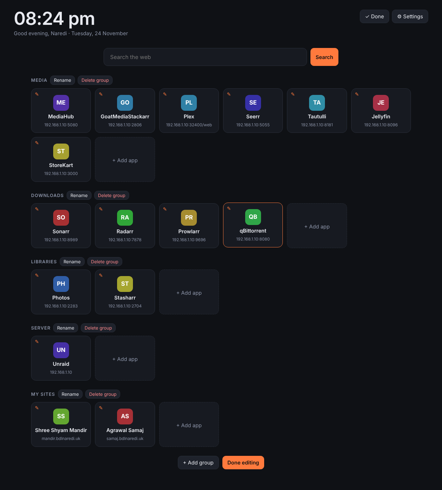

# HomeTab

A fast, private new tab page for Brave (and any Chromium browser) with one-click tiles for your self-hosted apps — MediaHub, GoatMediaStackarr, Plex, Sonarr, Radarr, Prowlarr, qBittorrent, Photos, Stasharr, Unraid and your own sites.

No tracking, no ads, no outside requests. Your tiles are stored only in your browser.

## Features

- Tiles grouped by Media, Downloads, Libraries, Server and My sites
- One server IP setting — every link with `{server}` points to it
- Edit mode: add, change, move or delete apps and groups right on the page
- Optional green/red online status dots
- Private search box (Brave Search, DuckDuckGo or Startpage)
- Back up and restore your tiles as a JSON file

## Install

1. Click **Code → Download ZIP** and unzip it into a folder you'll keep (for example `Documents\HomeTab`).
2. In Brave, open `brave://extensions` and turn on **Developer mode** (top right).
3. Click **Load unpacked** and choose the folder that contains `manifest.json`.
4. Open a new tab. If Brave asks whether to keep the changed new tab page, choose **Keep**.
5. Click **⚙ Settings**, enter your server's IP (for example `192.168.1.10`) and save.

## Updating

Download the new files into the same folder, then click the reload arrow on HomeTab in `brave://extensions`. Your tiles and settings are kept.

## Default ports

The default tiles use each app's usual port. Change any that differ on your server with **✎ Edit**.

| App | Port |
|---|---|
| MediaHub | 5080 |
| GoatMediaStackarr | 2806 |
| Plex | 32400 (`/web`) |
| Seerr | 5055 |
| Tautulli | 8181 |
| Jellyfin | 8096 |
| Sonarr | 8989 |
| Radarr | 7878 |
| Prowlarr | 9696 |
| qBittorrent | 8080 |
| Photos | 2283 |
| Stasharr | 2704 |

## License

MIT
